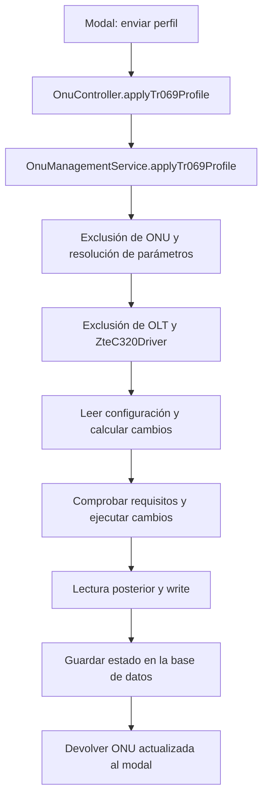

# Informe: depuración del modal «Aplicar Perfil TR-069»

Fecha: 2026-11-05. Alcance: análisis del código local y reproducciones sintéticas del planificador. No se modificó código de aplicación ni se ejecutaron comandos contra una OLT real.

## Conclusión principal

El backend de las dos acciones de configuración ya está conectado a métodos síncronos que llaman al driver de la OLT. El modal conserva una segunda lógica de seguimiento de operaciones que no corresponde al flujo directo solicitado.

Retirar esa lógica simplificará la interfaz, pero no basta para resolver todos los casos en los que el perfil no se aplica. Hay dos problemas comprobables adicionales:

1. El planificador bloquea antes de enviar configuración cuando encuentra transporte del canal 2 y no encuentra su ACS o su bind de gestión. Esto impide completar determinados intentos parciales. Se reprodujo localmente.
2. Una configuración confirmada y guardada puede quedar registrada como `PENDING`: el driver devuelve una advertencia porque no verificó el ACS y el servicio interpreta cualquier advertencia como una aplicación OLT pendiente. Este comportamiento se deriva directamente del código actual.

No se puede atribuir el incidente concreto de una ONU a una causa única sin la respuesta HTTP y el primer error CLI del intento. Las reproducciones de este informe acreditan condiciones de fallo del software, no el estado de la OLT del usuario.

## 1. Flujo solicitado y rutas que se deben conservar

El modal debe cargar la red elegida, permitir una vista previa, enviar una acción directa a la OLT, esperar el resultado y actualizar la ficha de la ONU. El seguimiento de trabajos en cola queda fuera de este alcance.

| Acción | Ruta | Servicio actual |
| --- | --- | --- |
| Cargar redes TR-069 | `GET /olt/tr069-networks` | `OltCatalogsService.findAllTr069Networks()` |
| Previsualizar | `POST /olt/onus/:id/preview-tr069-script` | `OnuManagementService.previewTr069ProfileScript()` |
| Aplicar perfil completo | `POST /olt/onus/:id/tr069-profile` | `OnuManagementService.applyTr069Profile()` |
| Actualizar solo ACS | `POST /olt/onus/:id/tr069-acs` | `OnuManagementService.updateTr069AcsUrl()` |
| Refrescar la ficha | `GET /olt/onus/:id` | `OnuManagementService.findById()` |

Las lecturas CLI necesarias para identificar la ONU, comprobar el contexto y confirmar la configuración forman parte de la ejecución directa. No implican encolar una operación ni consultar periódicamente trabajos desde el modal.

El acceso a credenciales PPPoE para fabricantes con aprovisionamiento manual es una funcionalidad adicional presente en el componente. Conviene separarla del modal de aplicación automática, sin modificar ese servicio de red dentro de esta depuración.

## 2. Recorrido real de «Aplicar Perfil»



Los controladores actuales llaman directamente a `this.onuService.applyTr069Profile()` y `this.onuService.updateTr069AcsUrl()`. No llaman a `OnuTr069OperationsService.create()` desde esos dos POST.

Evidencia: [onu.controller.ts](../src/modules/olt/onu.controller.ts), líneas 213–242; [onu-management.service.ts](../src/modules/olt/services/onu-management.service.ts), líneas 1337–1339 y 1400–1591.

La existencia de un worker y una tabla de operaciones en el proyecto no demuestra que esas acciones del modal estén encolando. Tampoco permite explicar el fallo de aplicación atribuyéndolo únicamente a Redis.

## 3. Hallazgos de la interfaz

### 3.1. Dependencia innecesaria del seguimiento de operaciones

`ApplyTr069ProfileModal.tsx:62` invoca `useTr069Operation()` cada vez que el modal está abierto. El hook consulta `tr069-operations/latest` y puede continuar consultando cada dos segundos si encuentra trabajo pendiente o si ocurre un error de consulta.

Esto incorpora al modal una dependencia adicional de rutas y registros de operaciones aunque los POST de configuración actuales sean directos. Si la consulta falla, aparece el mensaje «La operación continúa en el servidor» incluso cuando todavía no se ha enviado una acción nueva desde el formulario.

Además, el hook puede llamar a `onSuccess()` al encontrar una operación histórica aplicada o verificada. La apertura del modal puede producir así una notificación de éxito que no corresponde a una aplicación solicitada en ese momento.

La condición `active` actual requiere un `operationId` local; no es correcto afirmar que cualquier registro histórico pendiente bloquee automáticamente el botón al abrir. El problema comprobado es la mezcla de estados y mensajes de dos flujos distintos.

Evidencia: [modal](../../sumtech-frontend/src/components/modules/network/ApplyTr069ProfileModal.tsx), líneas 62 y 311–329; [hook](../../sumtech-frontend/src/components/modules/network/useTr069Operation.ts), líneas 24–66.

### 3.2. Dos contratos de respuesta dentro de cada botón

Los manejadores de aplicar perfil y actualizar ACS admiten simultáneamente:

- Respuesta con `operationId`: iniciar seguimiento.
- Respuesta síncrona: usar la ONU recibida o intentar recuperarla mediante un GET.
- Respuesta `202` sin identificador: mostrar un mensaje específico de operación asíncrona.

El contrato solicitado necesita una sola rama: esperar la aplicación directa, verificar el resultado devuelto, actualizar la ONU y mostrar el error o la confirmación correspondiente.

Actualmente el GET adicional solo se intenta si la respuesta no contiene `id`, `serialNumber` o `serviceConfig`. Sus errores se descartan y el componente puede llamar a `onSuccess()` con una respuesta incompleta. El padre incorpora un segundo mecanismo de recuperación de la ONU. Esta duplicación complica distinguir fallo de aplicación y fallo de refresco.

Evidencia: modal, líneas 191–279; [ficha de ONU](../../sumtech-frontend/src/app/(dashboard)/dashboard/red/onus/[id]/page.tsx), líneas 1252–1267.

### 3.3. Catálogo global y selección automática

El modal carga todas las redes TR-069 del tenant y selecciona la primera. El servicio ordena por nombre y no filtra por OLT en esa ruta. Existe otro método del catálogo, `getTr069NetworksForOlt()`, que sí calcula redes asociadas a una OLT, pero el modal no lo utiliza.

Por tanto, que una red aparezca seleccionada no acredita que su VLAN esté disponible en la OLT de la ONU. Es una causa posible de selección incorrecta y de rechazo posterior; no prueba que sea el fallo del intento concreto.

Se recomienda conservar la ruta solicitada y definir cómo filtrar o validar su catálogo según la OLT, además de validar la selección en el backend antes de configurar.

Evidencia: modal, líneas 100–104; [olt-catalogs.service.ts](../src/modules/olt/services/olt-catalogs.service.ts), líneas 775–791.

### 3.4. Previsualización y aplicación pueden solaparse

La previsualización puede abrir una sesión CLI y obtener el lock de la OLT. El botón de aplicación no incluye `previewLoading` entre sus condiciones de deshabilitación, por lo que puede iniciarse una aplicación mientras sigue en curso la vista previa.

El lock evita ejecutar ambas sesiones a la vez, pero puede introducir espera o un rechazo por ocupación. La simplificación debe impedir ese solapamiento desde el formulario y mantener el lock del backend.

## 4. Puntos que pueden impedir configurar la OLT

### 4.1. Rechazo de estados parciales del canal 2 — reproducido

`buildTr069Plan()` exige que un canal 2 existente tenga una línea de ACS y el bind exacto `switchport-bind switch_0/1 iphost 2`. Si falta cualquiera, aborta antes de generar los comandos de reparación.

Esto protege recursos ajenos, pero también bloquea un escenario normal de recuperación: un intento anterior creó TCONT/GEM/service-port y falló antes de completar OMCI. El nuevo intento no llega a añadir lo que falta.

Reproducción con fixtures sintéticos, sin OLT:

| Estado inicial | Resultado |
| --- | --- |
| ONU sin canal 2 | Plan de 17 pasos de cambio |
| Canal 2 completo con VLAN anterior | Plan de 9 pasos de cambio |
| Transporte del canal 2 existente y bloque OMCI ausente | Abortado: no se pudo acreditar la propiedad TR-069 |
| Transporte del canal 2 existente y bind ausente | Mismo aborto |

Los números describen la fixture local actual, no una receta universal de comandos.

Prioridad: distinguir un canal ajeno de un canal de gestión propio incompleto, usando identidad, asociaciones y evidencia del estado real. No eliminar simplemente la protección ni borrar el canal 2 a ciegas.

Evidencia: [zte-c320-tr069-state.ts](../src/modules/olt/drivers/zte-c320-tr069-state.ts), líneas 70–76.

### 4.2. Formato de lectura global obligatorio — condición reproducida

El parser exige el marcador `end`, bloques exactos de interfaz/gestión y un registro de serial con una estructura concreta. La ausencia de esos elementos detiene la operación antes de configurar.

Se reprodujo el rechazo de una lectura sin `end`. No se comprobó si el firmware de la OLT afectada entrega ese formato, otro distinto o una lectura truncada. Tampoco se ha medido cuánto tarda su `show running-config` completo.

La corrección debe validar las respuestas reales de esa OLT y valorar lecturas específicas de la ONU. No debe interpretar una respuesta desconocida como una ONU vacía.

Evidencia: archivo anterior, líneas 20–44; [zte-c320-tr069.ts](../src/modules/olt/drivers/zte-c320-tr069.ts), líneas 36–39.

### 4.3. Perfiles predefinidos y VLAN como requisitos previos

El flujo actual exige un perfil TCONT y un traffic-profile de bajada llamados `SMARTOLT-VOIPMNG-10M`, además de comprobar la VLAN. Si falta cualquiera de los perfiles o el parser no los identifica, aborta antes del primer cambio de configuración.

El mismo nombre corresponde a dos clases distintas de perfil: encontrar el TCONT no acredita que exista el traffic-profile. Debe comprobarse qué devuelve cada consulta en el intento real. Se mantiene la regla de no crear perfiles globales automáticamente.

Evidencia: `zte-c320-tr069.ts`, líneas 40–59.

### 4.4. Requisitos de Internet dentro del resolvedor de etapa 2

`performApplyTr069Profile()` requiere una fila previa de configuración de servicio y reutiliza `buildAuthorizeParams()`. Este resolvedor valida también el tipo de ONU y la VLAN de servicio de Internet.

Una ONU autorizada o importada puede quedar bloqueada por metadatos incompletos en la base de datos aunque su ubicación física esté disponible. Son precondiciones adicionales al objetivo de configurar su canal de gestión.

Conviene definir un resolvedor específico de TR-069 con los datos necesarios para esa acción, conservando la comprobación de identidad y autorización. No se debe inventar ni reescribir la configuración de Internet para superar la validación.

Evidencia: `onu-management.service.ts`, líneas 1412–1432 y 2115–2169.

### 4.5. Comparación literal de configuración y autenticación

La verificación posterior vuelve a calcular el plan y exige que no quede ninguna diferencia. Se comparan líneas completas, incluido el comando del ACS.

Se reprodujo una diferencia persistente cuando la lectura sintética contiene una contraseña enmascarada y la solicitud contiene su valor real. No se ha confirmado que la OLT afectada enmascare ese campo. Si lo hace, no podrá verificarse la equivalencia mediante comparación literal; además, una compensación no debe reenviar una clave enmascarada como si fuera la contraseña original.

La solución debe normalizar los campos observables y representar como desconocido lo que el equipo oculta, sin asumir equivalencia ni sobrescribir autenticación de forma especulativa.

Evidencia: `zte-c320-tr069-state.ts`, líneas 85–102; `zte-c320-tr069.ts`, líneas 95–97 y 144–156.

### 4.6. Contexto CLI y tiempos

El ejecutor reconoce un conjunto concreto de prompts. Un modo no reconocido detiene la operación. El lock físico espera hasta 30 segundos y los comandos tienen un timeout de hasta 20 segundos, dentro del presupuesto CLI.

Estas protecciones deben conservarse. Para una aplicación síncrona, también deben concordar los tiempos del backend, proxy y navegador con el trabajo que realmente realiza el script. Un timeout HTTP no demuestra que la OLT no haya recibido cambios y no debe provocar una repetición ciega.

Evidencia: [zte-command-executor.ts](../src/modules/olt/drivers/zte-command-executor.ts), líneas 8–13 y 38–79; [olt-io-lock.service.ts](../src/modules/olt/services/olt-io-lock.service.ts), líneas 21–38.

## 5. Inconsistencia comprobada: perfil aplicado registrado como pendiente

Tras confirmar configuración y `write`, el driver establece:

```text
ok = true
configurationStatus = confirmed
persistenceStatus = confirmed
status = applied_unverified
```

La ruta síncrona no realiza la comprobación ACS del worker. Por ello, el driver añade la advertencia «Configuración aplicada; comunicación ACS aún sin verificar».

Sin embargo, `performApplyTr069Profile()` decide `applyStatus` únicamente por la presencia de `warning`. Con esa advertencia establece `PENDING`, no avanza `appliedVersion` y guarda el aviso como `lastApplyError`. Después registra un evento de éxito y devuelve la ONU.

En el recorrido de éxito actual, la ausencia de verificación ACS puede presentarse como una etapa OLT pendiente aunque la lectura posterior y el guardado hayan sido confirmados. Esto es un defecto de interpretación del resultado, no evidencia de que falte configuración física.

La corrección debe basar el estado de aplicación OLT en configuración y persistencia confirmadas. La comunicación ACS debe mostrarse por separado, sin condicionar la confirmación de que el perfil se aplicó a la OLT.

Evidencia: `zte-c320-tr069.ts`, líneas 98–108 y 163; `onu-management.service.ts`, líneas 1455 y 1475–1500.

## 6. Particularidades de «Solo actualizar ACS»

La ruta síncrona llama al driver directamente y conserva intactos transporte, VLAN, filtros y otros recursos. No debe utilizarse para reparar un canal de gestión que todavía no existe.

Hay dos aspectos que conviene alinear con la aplicación completa:

- El payload del servicio no incluye `serialNumber`, aunque el driver admite ese dato para comprobar identidad. La acción aislada tiene así una comprobación de serial menos estricta.
- Usa el lock de OLT, pero no está envuelta en `wanProvisioning.withMutation()` como la aplicación completa. Debe conservar una exclusión de ONU coherente con las demás escrituras sobre ese equipo.

El método actual actualiza `tr069NetworkId` en la base de datos; cambiar la red seleccionada no significa que esta acción migre su VLAN física. La interfaz debe dejar claro que modifica el ACS, no todo el canal de una red diferente.

Evidencia: `onu-management.service.ts`, líneas 1513–1591.

## 7. Propuesta de depuración dentro del alcance solicitado

1. Retirar del modal `useTr069Operation`, las ramas `202/operationId`, el seguimiento periódico y la presentación de trabajos históricos. No borrar indiscriminadamente servicios o tablas usados por otras partes del sistema.
2. Unificar ambos manejadores en un flujo directo: validar, enviar, esperar resultado, actualizar ONU y mostrar confirmación o error. No disparar `onSuccess()` por abrir el modal.
3. Establecer un contrato síncrono claro para las dos acciones, con resultado de aplicación OLT separado del aviso ACS. Usar un único responsable del refresco de la ficha.
4. Corregir la persistencia de `applyStatus/appliedVersion` según la confirmación de configuración y guardado, no según cualquier advertencia.
5. Resolver el rechazo de estados parciales del canal 2 mediante evidencia de propiedad, sin borrar recursos ajenos ni tocar Internet.
6. Contrastar lecturas, prompts, perfiles y resultado de cada comando con un intento real antes de cambiar parsers o sintaxis. Conservar la protección de secretos en los registros.
7. Validar red seleccionada, serial, ubicación, credenciales y exclusión de ONU de forma consistente en ambas acciones.
8. Impedir la ejecución simultánea de vista previa y aplicación desde el modal. Mantener la exclusión física del backend.

Se mantienen como condiciones obligatorias: cero reinicios automáticos, cero cambios de políticas globales de OLT, ningún perfil global creado automáticamente y ningún éxito limpio cuando un comando requerido haya sido rechazado.

## 8. Evidencia necesaria para cerrar el incidente concreto

Del siguiente intento basta registrar, sin contraseñas:

- Ruta ejecutada, ONU/interfaz objetivo y red seleccionada.
- Código HTTP y mensaje completo de error devuelto al modal.
- Etapa alcanzada y primer comando rechazado, con su respuesta CLI sanitizada.
- Si se llegó a ejecutar `configure terminal`, si hubo comandos de configuración y si se alcanzó `write`.
- Configuración dirigida de esa ONU antes y después del intento.

Esto permitirá distinguir: aplicación no iniciada, preflight bloqueado, comandos rechazados, cambios parciales, configuración guardada con estado de base de datos incorrecto o perfil aplicado sin conectividad ACS.

Este informe no modifica la implementación. Las reproducciones ejecutaron únicamente funciones locales de lectura/planificación con fixtures sintéticos.
